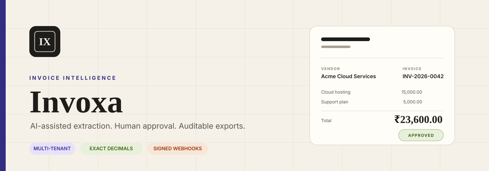
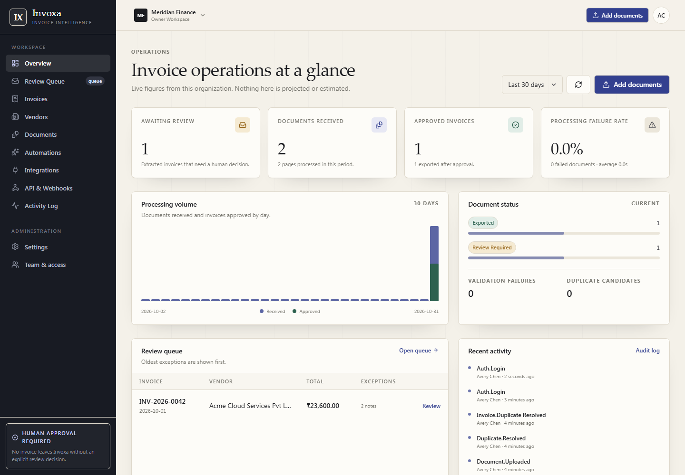
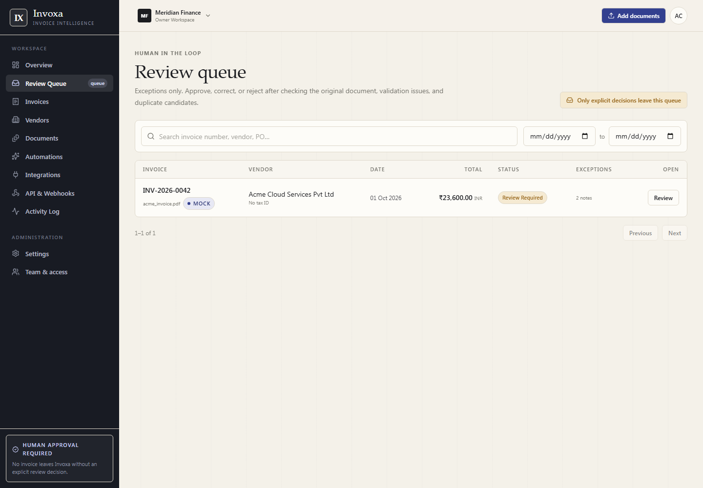
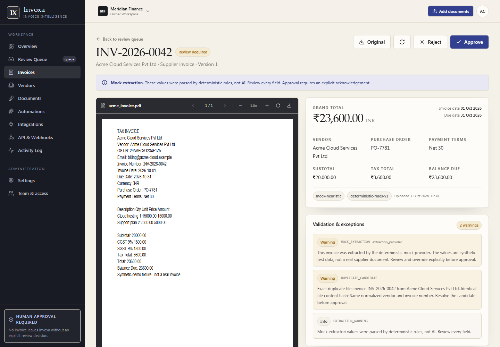
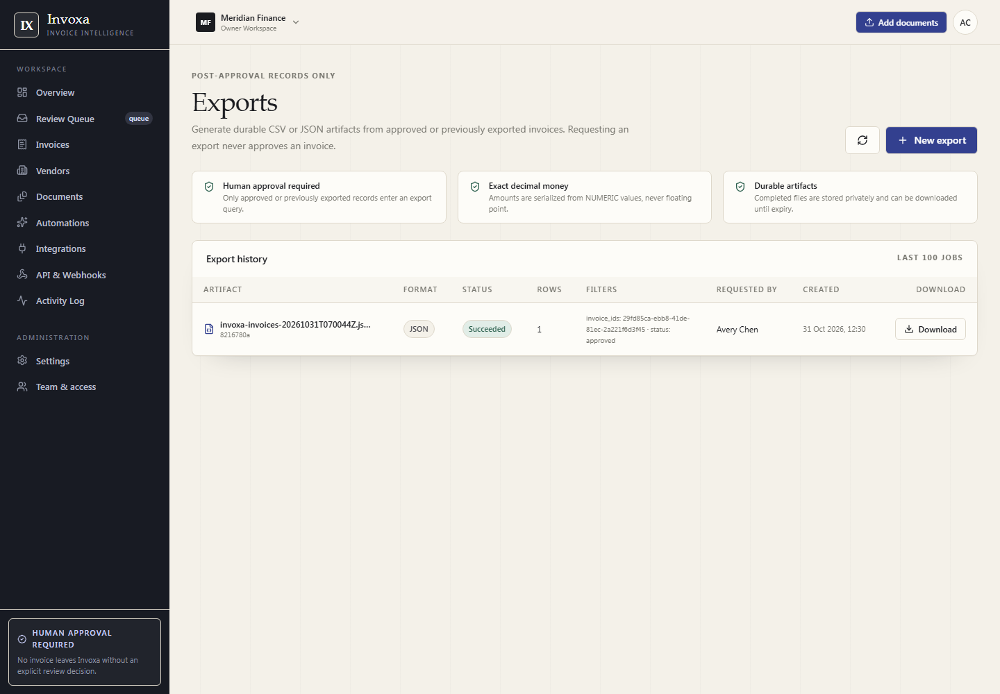
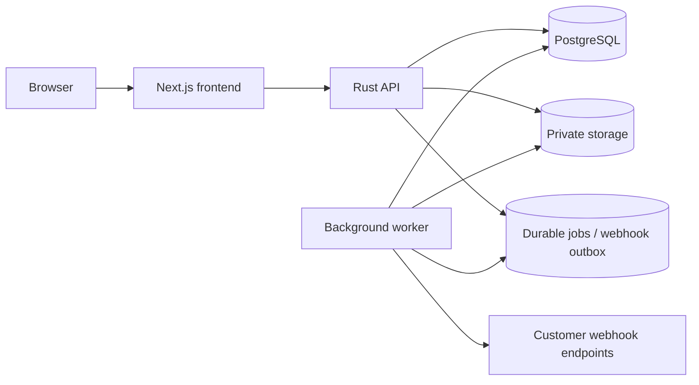

<div align="center">
  
</div>

<h1 align="center">Invoxa</h1>

<p align="center">
  A multi-tenant accounts-payable workspace for invoice extraction, validation, review, approval, and export.
</p>

<p align="center">
  <a href="https://github.com/CyberBoyNitin/invoxa/actions/workflows/ci.yml"></a>
  
  
  
  
  <a href="LICENSE"></a>
</p>

> **Project status:** a working, tested MVP. The critical invoice workflow runs end to end, but this is not a production-audited system. See [Known limitations](#known-limitations) and the [delivery report](DELIVERY_REPORT.md).

## Why Invoxa

Invoice operations fail when extraction is treated as truth. Invoxa keeps the human decision explicit:

- **Extraction is untrusted.** AI and OCR output is validated, scored, and shown with provenance.
- **Money is exact.** Values use PostgreSQL `NUMERIC(18,4)` and Rust `Decimal`; API responses use decimal strings, never floats.
- **Approval is a server transition.** Invalid invoices, unresolved errors, and confirmed duplicates cannot be approved or exported.
- **Tenant isolation is enforced in SQL.** Every tenant-scoped query is scoped by the authenticated organization.
- **Exports are durable and auditable.** CSV/JSON artifacts are generated by a worker and downloaded through authenticated routes.
- **Webhooks are signed and SSRF-checked.** Events use a durable outbox, HMAC signatures, retries, and delivery history.

## Screenshots

Screenshots are from a disposable demo workspace using the deterministic mock provider. They contain synthetic data only.

| Dashboard | Review queue |
| --- | --- |
|  |  |

| Invoice review workspace | Exports |
| --- | --- |
|  |  |

## Features

### Ingestion and processing

- PDF, PNG, JPEG, and TIFF uploads with MIME, extension, magic-byte, size, page, and pixel validation.
- Private local object storage with SHA-256 content hashing and opaque keys.
- Durable PostgreSQL-backed processing jobs with leases, retries, bounded concurrency, and job detail endpoints.
- Digital PDF text extraction with `pdf-extract` and image OCR with Tesseract TSV output.
- Configurable extraction providers: deterministic mock provider and OpenAI-compatible structured output.
- External AI is gated by owner-controlled organization consent.

### Review and accounting

- Structured invoice, line-item, tax, vendor, and provenance records.
- Exact decimal arithmetic, arithmetic tolerance, missing-value preservation, and duplicate detection.
- Review queue with blocking counts, source document preview, validation issues, and duplicate candidates.
- Optimistic concurrency for corrections, internal notes, and append-only approval history.
- Explicit approve, reject, and return-for-correction transitions.
- Mock extraction is visibly labelled and requires explicit acknowledgement.

### Exports and integrations

- Durable CSV/JSON exports with date, vendor, status, and selected-invoice filters.
- Approved-only policy enforced at queue time and again by the worker.
- Authenticated artifact downloads and export history.
- Scoped, hashed, revocable API keys with one-time secret reveal.
- Signed webhook endpoints with secret rotation, SSRF prevention, retry history, dead-letter visibility, and manual redelivery.

### Workspace

- Multi-tenant organizations, owner/admin/accountant/reviewer/read-only roles, invitations, and organization switching.
- Dashboard, activity/audit log, usage metrics, vendors, automation rules, integrations status, and settings.
- Editorial finance UI with accessible tables/forms, PDF.js viewer, and responsive layouts.

## Architecture



- The frontend and API share an origin through Next.js rewrites.
- The API and worker are separate processes sharing PostgreSQL and private storage.
- PostgreSQL is the source of truth for jobs, exports, webhooks, approvals, and audit events.
- The worker claims jobs with `FOR UPDATE SKIP LOCKED` and leases; no in-memory queue is required.
- Cross-tenant resources return `404`, not `403`, to avoid confirming existence.

More detail: [`docs/ARCHITECTURE.md`](docs/ARCHITECTURE.md).

## Tech stack

| Layer | Technology |
| --- | --- |
| Frontend | Next.js 16.4, React 19.3, TypeScript 5.9, Tailwind CSS 4.3, TanStack Query 5.105 |
| PDF viewer | `pdfjs-dist` 6.4 |
| Backend | Rust 1.98, Axum 0.8, SQLx 0.8, tower-http 0.6 |
| Database | PostgreSQL 17, versioned migrations |
| OCR | Tesseract 5.4 |
| PDF text | `pdf-extract` 0.12 |
| Money | `rust_decimal`, `NUMERIC(18,4)` |
| Security | Argon2, HttpOnly sessions, signed CSRF, AES-GCM, HMAC-SHA256 |

## Quick start

### Docker Compose (fastest evaluation)

Requirements: Docker with Compose.

```bash
git clone https://github.com/CyberBoyNitin/invoxa.git
cd invoxa
cp .env.docker.example .env.docker
```

Generate independent keys and replace the placeholders in `.env.docker`:

```bash
openssl rand -base64 32
```

At minimum set:

```dotenv
POSTGRES_PASSWORD=<long-url-safe-password>
ENCRYPTION_KEY=<base64-32-bytes>
CSRF_SECRET=<different-base64-32-bytes>
```

Start the stack:

```bash
docker compose --env-file .env.docker up --build
```

Open <http://localhost:3000> and create a workspace. Optional demo data:

```bash
docker compose --env-file .env.docker exec api invoxa-seed
```

Demo credentials created by the seed:

```text
Email:        demo@invoxa.local
Password:     InvoxaDemo!2026
Organization: Northstar Demo Company
```

Do not run the demo seed on a public production instance. The Compose stack defaults to development settings; see [`docs/DEPLOYMENT.md`](docs/DEPLOYMENT.md) for the production override and TLS guidance.

### Local development

Requirements:

- Rust stable (tested with 1.98.1)
- Node.js 24+ and npm
- PostgreSQL 17
- Tesseract 5.4
- `pdf-extract` system dependencies if required by your platform

Create a database and environment file:

```bash
createdb invoxa
cp .env.example .env
```

Set `DATABASE_URL`, `TESSERACT_PATH`, `ENCRYPTION_KEY`, and `CSRF_SECRET`. Generate keys with:

```bash
openssl rand -base64 32
```

Run the backend from the repository root:

```bash
# Terminal A: migrate and create the demo workspace
cargo run -p invoxa-api --bin invoxa-seed

# Terminal B: API
cargo run -p invoxa-api --bin invoxa-api

# Terminal C: worker
cargo run -p invoxa-api --bin invoxa-worker
```

Run the frontend:

```bash
cd apps/web
npm ci
npm run dev
```

Open <http://localhost:3000>. For a production build, use `npm run build && npm run start`.

The API reads `.env` from the workspace root. On Windows, use forward slashes in `TESSERACT_PATH`:

```dotenv
TESSERACT_PATH=C:/Program Files/Tesseract-OCR/tesseract.exe
```

Full setup and troubleshooting: [`docs/SETUP.md`](docs/SETUP.md).

## Configuration

All configuration is environment-based. Start from [`.env.example`](.env.example).

| Variable | Required | Purpose |
| --- | --- | --- |
| `DATABASE_URL` | Yes | PostgreSQL connection string |
| `ENCRYPTION_KEY` | Yes | Base64 32-byte key for encrypted webhook secrets |
| `CSRF_SECRET` | Yes | Independent base64 32-byte CSRF signing key |
| `TESSERACT_PATH` | For OCR | Path to the Tesseract executable |
| `APP_URL` | Production | Public HTTPS URL |
| `ALLOWED_ORIGINS` | Yes | Browser origins allowed to call the API |
| `STORAGE_ROOT` | Yes | Private document/export storage path |
| `AI_PROVIDER` | Yes | `mock` or `openai` |
| `AI_BASE_URL`, `AI_MODEL`, `AI_API_KEY` | For real AI | OpenAI-compatible provider settings |
| `COOKIE_SECURE` | Production | Must be `true` behind HTTPS |
| `TRUST_PROXY` | Production | Set only behind a trusted reverse proxy |
| `EXPOSE_DEV_TOKENS` | Development | Returns invitation/reset links when email is unavailable |

External AI also requires owner consent in **Settings → Organization**. Missing AI values remain `null`; they are never replaced with invented defaults.

## Testing

Backend:

```bash
cargo fmt --all -- --check
cargo clippy --workspace --all-targets
cargo test --workspace
```

Frontend:

```bash
cd apps/web
npm run typecheck
npm run build
```

Integration and security scripts require a running API, worker, PostgreSQL, and frontend:

```bash
node scripts/smoke.mjs
node scripts/security-smoke.mjs
node scripts/webhook-smoke.mjs

cd apps/web
node scripts/ui-e2e.mjs
node scripts/ui-audit.mjs
```

Current verified results:

| Suite | Result |
| --- | --- |
| Rust unit tests | 88 passed, 0 failed |
| Critical-path API smoke | `SMOKE OK` |
| Cross-tenant security smoke | `SECURITY SMOKE OK` |
| Webhook outbox/redelivery smoke | `WEBHOOK SMOKE OK` |
| Browser end-to-end | `UI E2E OK`; 0 page/console/network errors |
| Route audit | 12 routes; 0 errors |

The test scripts create disposable organizations. The browser test uses synthetic fixtures and does not touch real customer data.

## Security

- Every tenant-scoped query filters by `organization_id`; cross-tenant reads and mutations are covered by a two-organization smoke test.
- API keys are high-entropy, hashed at rest, scoped, expiring, rate-limited, and revocable. Secrets are shown once.
- Webhooks require HTTPS, resolve and reject private/loopback/link-local destinations on every attempt, do not follow redirects, and use timestamped HMAC-SHA256 signatures.
- Browser sessions use HttpOnly cookies and a signed double-submit CSRF token.
- Approval re-checks status, version, blocking issues, duplicates, and mock acknowledgement on the server.
- Exports re-check tenant ownership and post-approval status before queueing and again in the worker.
- AI output is untrusted and schema-validated; mock output is explicitly labelled.

Read the full model and tested properties in [`docs/SECURITY.md`](docs/SECURITY.md). Report vulnerabilities through the process in [`SECURITY.md`](SECURITY.md), not a public issue.

## API

The machine-readable route inventory is served at:

```text
GET /api/v1/openapi.json
```

Highlights:

```text
POST   /api/v1/documents
GET    /api/v1/jobs/{job_id}
GET    /api/v1/invoices
PATCH  /api/v1/invoices/{invoice_id}
POST   /api/v1/invoices/{invoice_id}/approve
POST   /api/v1/invoices/{invoice_id}/reject
POST   /api/v1/invoices/{invoice_id}/return
POST   /api/v1/exports
GET    /api/v1/exports/{export_id}/download
GET    /api/v1/webhook-deliveries
POST   /api/v1/webhook-deliveries/{delivery_id}/redeliver
```

See [`docs/API.md`](docs/API.md) for auth, request/response conventions, webhook signature verification, and examples.

## Deployment

GitHub Pages cannot host this application. A public repo is source distribution, not a running service. You need a host for the API, worker, PostgreSQL, and persistent storage.

The repository includes:

- `Dockerfile.api` — API, worker, and seed binaries with Tesseract.
- `Dockerfile.web` — production Next.js build.
- `docker-compose.yml` — local/staging stack.
- `docker-compose.prod.yml` — production-shaped overrides.
- `docs/DEPLOYMENT.md` — VPS, TLS, secrets, backups, scaling, and production checklist.

For a small production deployment, a Linux VPS with Docker Compose and Caddy is the simplest fit because the API and worker share local storage. The full steps are in [`docs/DEPLOYMENT.md`](docs/DEPLOYMENT.md).

## Repository layout

```text
apps/api/                 Axum HTTP API, worker, and seed binaries
apps/web/                 Next.js App Router frontend
crates/domain/            Invoice/status/role/validation domain types
crates/database/          SQLx queries, transactions, migrations glue
crates/documents/         Upload validation, local storage, PDF/OCR
crates/extraction/        Provider abstraction, mock and OpenAI-compatible providers
crates/workflows/         Durable document/export/webhook workflows
crates/integrations/      CSV/JSON builders and signed webhook delivery
crates/security/          Sessions, CSRF, API keys, encryption, password hashing
migrations/               Versioned PostgreSQL schema
scripts/                  API, security, and webhook smoke tests
fixtures/                 Synthetic test invoices
docs/                     Architecture, security, API, setup, deployment
```

## Known limitations

- **Scanned-PDF rasterization is not implemented.** Digital PDF text and direct image OCR work; a scanned PDF without a text layer fails rather than inventing values.
- **Local disk storage only.** The S3 adapter is not implemented; production must use persistent encrypted storage or add one.
- **No email delivery.** Invitations and reset links are manual in development.
- **No OAuth/accounting connectors.** Exports, API keys, and webhooks are the integration surface.
- **Mock extraction is the default.** It is deterministic, labelled, and requires acknowledgement; it is not suitable for real accounting decisions.
- **No malware scanner.** Upload validation does not replace antivirus scanning at ingest.
- **Open signup is enabled.** Add an allowlist or invite-only gate before exposing a private beta.
- **Not production-audited.** No third-party penetration test, load test, or disaster-recovery exercise has been performed.
- **Docker artifacts are provided but should be validated on the target host.**

## Roadmap

- [x] Multi-tenant invoice workflow with explicit approval
- [x] Durable jobs, exports, API keys, and signed webhooks
- [x] Cross-tenant security and browser E2E tests
- [ ] PDFium rasterization for scanned PDFs
- [ ] S3-compatible object storage
- [ ] Email delivery for invitations and password reset
- [ ] OAuth/accounting connectors
- [ ] Malware scanning, retention policies, and production observability
- [ ] Deployment automation and load testing

## Documentation

- [Architecture](docs/ARCHITECTURE.md)
- [Security model](docs/SECURITY.md)
- [API reference](docs/API.md)
- [Local setup](docs/SETUP.md)
- [Deployment](docs/DEPLOYMENT.md)
- [Delivery report](DELIVERY_REPORT.md)

## Contributing

See [`CONTRIBUTING.md`](CONTRIBUTING.md). Security reports should follow [`SECURITY.md`](SECURITY.md).

## License

MIT — see [`LICENSE`](LICENSE).
